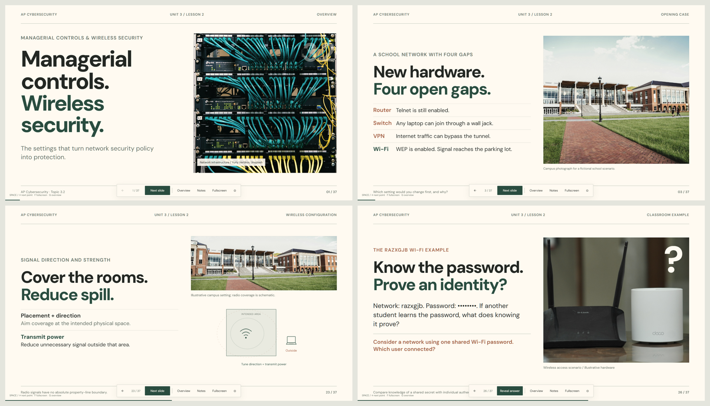

# Topic 3.2: Managerial Controls & Wireless Security

An independent, English-language classroom presentation for AP Cybersecurity Unit 3. The 37 slides use large key points, photographs, animated network diagrams, discussion prompts, and separate answer pages. Suitable for introductory lessons after basic networking vocabulary.

| Resource | Format | Access |
|---|---|---|
| [Download the presentation](index.html) | Single-file HTML, approximately 4 MB | Free; runs offline in a modern browser |
| [Preview](preview.png) | Four slide screenshots | Cover, opening case, signal coverage, and Wi-Fi discussion |

## Open and present

1. Open [index.html](index.html) on GitHub, then use **Download raw file** to save it locally. GitHub's file view displays the source rather than running the presentation.
2. Open the downloaded HTML in a current Chrome, Edge, or Firefox browser. Images, fonts, CSS, and JavaScript are embedded; no server, account, installation, or network connection is needed.
3. Press **F** for fullscreen. Use **Space** or **Right Arrow** to reveal the next point, then move to the next slide.

| Control | Action |
|---|---|
| Space / Right Arrow / canvas click | Next point or slide |
| Left Arrow | Previous point or slide |
| Page Down / Page Up | Adjacent slide |
| Home / End | First / last slide |
| G | Slide overview |
| N | Teacher notes and source links |
| F | Toggle fullscreen |
| R | Restart the current slide's reveals |
| Escape | Close a panel |
| Settings | Choose cinematic or reduced motion |
| Horizontal swipe | Previous / next point on touch screens |

System reduced-motion preferences are respected. The 16:9 canvas scales to the browser window; a large display is recommended for teaching. Speaker notes appear on the same screen, so open them before projecting or when students are working independently.

## Teaching scope

- **3.2.A — Managerial controls:** router, switch, VPN, and wireless policies; secure management; physical ports; split and full tunneling.
- **3.2.B — Wireless configuration:** WEP, WPS, original WPA, WPA3, AES, EAP, SSID discovery, signal coverage, encryption, and authentication.
- **Practice:** a fictional school-network case, policy checks, wireless scenarios, and independent practice.
- **Classroom discussions:** a student whose VPN repeatedly times out (cause unconfirmed), and whether knowing a shared Wi-Fi password proves an individual identity. The Wi-Fi example displays a masked placeholder; it contains no usable password.

WPS is distinguished from encryption, hidden SSIDs from strong access controls, and EAP authentication from WPA3/AES encryption roles. VPN troubleshooting starts with evidence rather than assuming a cause. The deck contains no instructor introduction or portrait.

## Sources

This is independently written teaching material aligned to Topic 3.2, not an official College Board slide deck. Official PDFs, AP Classroom files, and the source website's assets are not included.

- [Teacher Yang's Unit 3, Lesson 2 outline](https://learn.orzy.top/courses/ap-cybersecurity/lecture/unit3-lesson2).
- [College Board AP Cybersecurity](https://apcentral.collegeboard.org/courses/ap-cybersecurity): Course and Exam Description, Topic 3.2, printed pages 73–74 in the source edition. Slide notes identify the supplied CED filename and page references.
- [Microsoft: VPN routing decisions](https://learn.microsoft.com/en-us/windows/security/operating-system-security/network-security/vpn/vpn-routing).
- [Cisco: Wireless security FAQ](https://www.cisco.com/c/en/us/support/docs/wireless-mobility/wlan-security/68583-FAQ-Wireless-Security.html).
- [CERT/CC VU#723755: WPS PIN vulnerability](https://www.kb.cert.org/vuls/id/723755/).
- [SlidesCarnival Clean Minimal](https://www.slidescarnival.com/template/clean-minimal/44606): visual reference for the cream/sage direction. The HTML layout and SVG diagrams were created separately; no template file is bundled.

## License and asset credits

The original lesson text, presentation code, layout, and SVG diagrams are contributed under the repository's [CC BY 4.0 license](../../../LICENSE). Third-party images and fonts retain the licenses below; they are excluded from that CC BY 4.0 grant.

The photographs are cropped by the presentation layout and color-adjusted with CSS. They illustrate concepts and do not establish the actual security configuration of a photographed device, workspace, or campus.

| Embedded asset | Creator / source | License |
|---|---|---|
| Network infrastructure | [Yuriy Vertikov / Unsplash](https://unsplash.com/photos/c-lSQecD9oI) | [Unsplash License](https://unsplash.com/license) |
| Network switches | [Matthew Henry / Burst / Shopify](https://www.shopify.com/stock-photos/photos/network-server-switches) | [CC0](https://www.shopify.com/stock-photos/licenses/creative-commons) |
| Wireless routers | [TechieTech Tech / Unsplash](https://unsplash.com/photos/a-couple-of-routers-sitting-on-top-of-a-table-6ZXP-5-jJts) | [Unsplash License](https://unsplash.com/license) |
| Ethernet connector | [Quaritsch Photography / Unsplash](https://unsplash.com/photos/_fQ6zg_McEU) | [Unsplash License](https://unsplash.com/license) |
| Laptop workspace | [Andrew Neel / Unsplash](https://unsplash.com/photos/laptop-on-table-near-cup-9moikpaufvg) | [Unsplash License](https://unsplash.com/license) |
| Campus | [Erika Fletcher / Unsplash](https://unsplash.com/photos/brown-and-white-concrete-building-MZxqc6n9qCw) | [Unsplash License](https://unsplash.com/license) |
| DM Sans, weights 400/600/800 | [DM Sans Project Authors / Google Fonts](https://github.com/google/fonts/tree/main/ofl/dmsans) | [SIL Open Font License 1.1](DM-Sans-OFL.txt), also embedded in the HTML source |

Image credits are available in the relevant slide's teacher notes. The preview uses the same assets and licenses.
